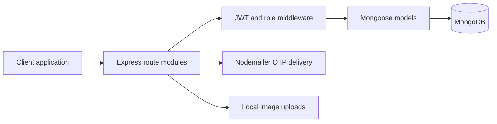

# Travel Planner API

**Account and itinerary services for a travel-planning application.**

An Express API with MongoDB models for users and travel plans. The implementation includes email-OTP registration, token-based sign-in, administrative plan management, and user-saved plans.

## Why this project exists

Travel applications need a clear separation between public account flows, operator-managed content, and each user's saved choices. This backend explores those boundaries with route modules and role-aware middleware.

## Run locally

Use Node.js/npm, MongoDB, and an email account suitable for the Nodemailer configuration in `models/user.js`. Configure these values in a local `.env` file:

- `MONGO_URI`
- `JWT_SECRET`
- `EMAIL` and `EMAIL_PASSWORD`
- `PORT` (optional; defaults to 5000)

```bash
npm install
npm start
```

## Route groups

| Prefix | Responsibilities |
|---|---|
| `/api/auth` | Signup, OTP verification, and login |
| `/api/admin` | Create and delete travel plans with administrative authorization |
| `/api/user` | Save a travel plan and retrieve saved plans |

Protected routes read a bearer token from the `Authorization` header. Plan creation accepts an image through the upload middleware.

## Architecture



## Source guide

[`app.js`](app.js) connects the database and mounts routes. [`routes/`](routes) contains account, admin, and user operations. [`models/`](models) defines users and travel plans. [`middleware/auth.js`](middleware/auth.js) checks token identity and allowed roles.

## Development status

OTP state is currently held in memory. Registration also hashes passwords in both the verification route and the user-model save hook; reconcile those paths before expecting registered accounts to authenticate correctly. Administrative role provisioning and upload storage must match the deployment you build around this API. The package's test command is a placeholder.
